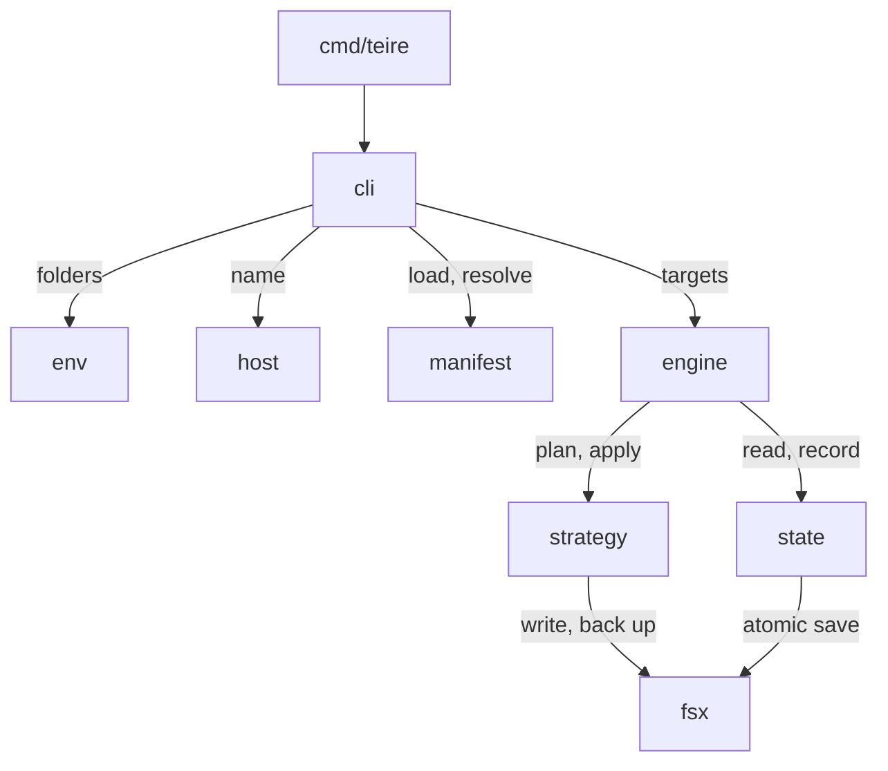

# Architecture

## Manifest

A dotfiles repository has one `teire.toml` at its root. A package is a folder
in the repository, and its layout mirrors its target folder. The package name
is also the name of its source folder, unless the package sets `source`.

Each file in a package uses the package strategy, which is `link` by default.
A file needs its own entry only when it differs from its package.

```toml
[package.claude]
target = "~/.claude"

[package.claude.file."claude.json"]
strategy = "merge"
target   = "~/.claude.json"
own      = ["mcpServers.notes"]

[host.work.package.claude]
target = "~/.claude-work"
```

The base entries describe the default machine. A host section changes only
what differs on one machine: a package target, a file target, or an extra
package.

Teire finds the host name in this order:

1. The `--host` flag.
2. The file `~/.config/teire/host`, which `teire init --host` writes. Teire
   never manages this file.
3. The output of `scutil --get LocalHostName`.

The host file exists because two Macs can have the same default name.

## Strategies

| Strategy | Apply writes                                    | State records           |
| -------- | ----------------------------------------------- | ----------------------- |
| `link`   | A symlink from the target to the source file.   | That Teire made it.     |
| `folder` | One symlink for the whole folder.               | That Teire made it.     |
| `merge`  | The target with each owned path set or deleted. | Owned paths and hashes. |

`merge` is for a file that another program also writes, such as
`.claude.json`. Teire owns only the paths in `own`:

- It sets and deletes owned paths with `sjson`, and keeps all other bytes. A
  new value goes in compact, at the end of its object. Claude Code formats
  the file again on its next write.
- It keeps the file mode, and replaces the file with an atomic rename.
- After the write, it reads the file again and reports each owned value that
  did not stay.
- It deletes a path that left `own` only if state shows that Teire set it.
- It does not create a target file that does not exist.

`link` and `folder` replace a target without a question in three cases only:

- The target is a link to the same file through another path, such as
  `~/.dotfiles`.
- The target is a link to a path that no longer exists, such as a file that
  moved inside the repository.
- The target is a plain file with the same bytes as the source.

A target below a folder that links into the repository is a conflict, because
a link made there would land in the repository itself. When an entry leaves the
manifest, Teire removes its link only while the link still points where Teire
made it point.

## State and conflicts

The state of the last apply is in `$XDG_STATE_HOME/teire/state.json`, with one
entry for each absolute target path. The state is per machine, so it stays out
of the repository.

| Source  | Target  | Action                                 |
| ------- | ------- | -------------------------------------- |
| same    | same    | Nothing.                               |
| changed | same    | Write the target.                      |
| same    | changed | Report it, and leave the target alone. |
| changed | changed | A conflict.                            |

Without state, Teire sets an owned path that the target does not have, and
treats each other difference as a conflict.

On a terminal, `apply` asks about each conflict: show the diff, overwrite the
target, or skip it. Without a terminal, `apply` skips each conflict, applies
the rest, and exits with 2.

Before Teire overwrites or merges into a target, it saves the old target in
`$XDG_STATE_HOME/teire/backups/<timestamp>/`.

## Commands

- `plan` shows each change and conflict, and writes nothing. It runs when no
  command is given. It exits with 0 when all is in place, 1 for changes, and 2
  for conflicts.
- `apply` shows the plan, asks once on a terminal, then writes. `--yes` skips
  the question, and is needed when stdin is not a terminal.
- `adopt <path>` moves a plain file into the source folder of the deepest link
  package whose target holds it, then links the file back.
- `init --host <name>` writes the host file.

Teire finds the repository from `--repo`, or else from the nearest folder at or
above the current one that holds `teire.toml`.

## Packages



The packages follow these boundaries:

- `cmd/teire` calls only `internal/cli`.
- `internal/cli` is the only package that imports cobra. Its commands call the
  other packages through plain functions.
- `internal/env` is the only package that reads environment variables.
- `internal/fsx` is the only package that writes to disk.
- Each package gets the home, repository, state and config folders from an
  `Env` parameter. So tests run each package against a temporary home.
