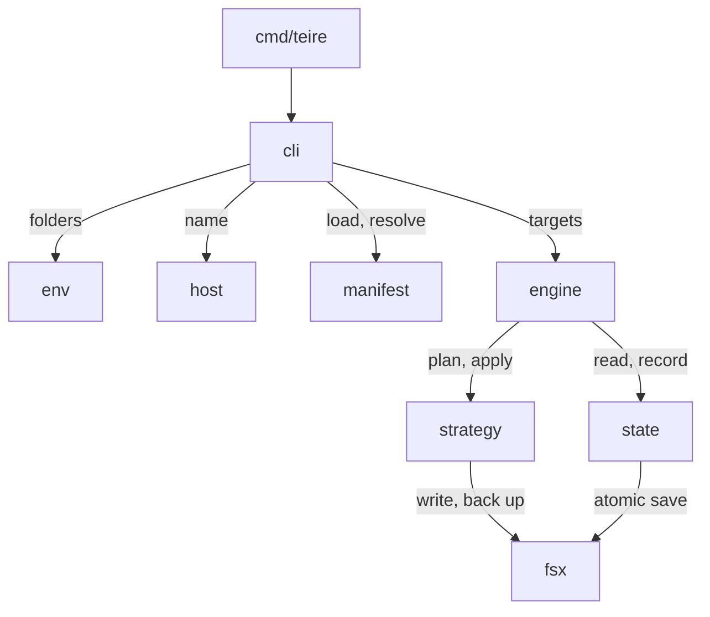

# Architecture

## Manifest

A dotfiles repository has one `teire.toml` at its root. A package is a folder
in the repository, and its layout mirrors its target folder. The package name
is also the name of its source folder, unless the package sets `source`.

Teire knows the target and strategy of common packages. A folder with one of
these names is a package without an entry in `teire.toml`:

| Package     | Target                | Strategy |
| ----------- | --------------------- | -------- |
| `alacritty` | `~/.config/alacritty` | `files`  |
| `bash`      | `~`                   | `files`  |
| `claude`    | `~/.claude`           | `files`  |
| `fish`      | `~/.config/fish`      | `files`  |
| `gh`        | `~/.config/gh`        | `files`  |
| `ghostty`   | `~/.config/ghostty`   | `files`  |
| `git`       | `~`                   | `files`  |
| `helix`     | `~/.config/helix`     | `files`  |
| `kitty`     | `~/.config/kitty`     | `files`  |
| `mise`      | `~/.config/mise`      | `files`  |
| `nvim`      | `~/.config/nvim`      | `folder` |
| `starship`  | `~/.config`           | `files`  |
| `tmux`      | `~/.config/tmux`      | `files`  |
| `vim`       | `~`                   | `files`  |
| `wezterm`   | `~/.config/wezterm`   | `files`  |
| `zed`       | `~/.config/zed`       | `files`  |
| `zsh`       | `~`                   | `files`  |

Any other folder is a package only when `teire.toml` declares it, and it then
defaults to `~/.config/<name>` with `files`. An entry changes only what differs
from these defaults. A known folder that a declared package uses as its
`source` is not a package of its own.

The `ignore` list stops a known folder from becoming a package. It does not
touch a declared package: a name that is both declared and ignored is an error.
A host section has its own `ignore` list, which adds to the base list on that
machine. A package that was applied before and is now ignored is no longer
managed, so the next apply removes its links.

```toml
ignore = ["nvim", "zed"]

[host.work]
ignore = ["zsh"]
```

Each file in a package uses the package strategy. A file needs its own entry
only when it differs from its package.

```toml
[package.claude.file."claude.json"]
strategy = "merge"
target   = "~/.claude.json"
own      = ["mcpServers.notes"]

[host.work.package.claude]
target = "~/.claude-work"
```

The base entries describe the default machine. A host section changes only
what differs on one machine: a package target, a file target, or an extra
package.

Teire finds the host name in this order:

1. The `--host` flag.
2. The file `~/.config/teire/host`, which `teire init --host` writes. Teire
   never manages this file.
3. The output of `scutil --get LocalHostName`.

The host file exists because two Macs can have the same default name.

## Strategies

| Strategy | Apply writes                                    | State records           |
| -------- | ----------------------------------------------- | ----------------------- |
| `files`  | A symlink for each file in the package folder.  | That Teire made it.     |
| `folder` | One symlink for the whole folder.               | That Teire made it.     |
| `merge`  | The target with each owned path set or deleted. | Owned paths and hashes. |

`files` makes each folder in the target a real folder and links only the files
that the package holds. So everything else a program writes into that folder,
such as the history and caches in `~/.claude`, stays out of the repository.
`folder` makes the whole target folder one link instead.

`merge` is for a file that another program also writes, such as
`.claude.json`. Teire owns only the paths in `own`:

- It sets and deletes owned paths with `sjson`, and keeps all other bytes. A
  new value goes in compact, at the end of its object. Claude Code formats
  the file again on its next write.
- It keeps the file mode, and replaces the file with an atomic rename.
- It writes an owned path only while the target still holds the value that the
  plan saw. A value that changed between the plan and the apply is left alone,
  and the next plan shows it again.
- After the write, it reads the file again and reports each owned value that
  did not stay. A running Claude Code session keeps the keys that Teire
  writes: its next rewrite of `.claude.json` carries them, so a merge does not
  need Claude Code closed.
- It deletes a path that left `own` only if state shows that Teire set it.
- It does not create a target file that does not exist.

`files` and `folder` replace a target without a question in three cases only:

- The target is a link to the same file through another path, such as
  `~/.dotfiles`.
- The target is a link to a path that no longer exists, such as a file that
  moved inside the repository.
- The target is a plain file with the same bytes as the source.

A target below a folder that links into the repository is a conflict, because
a link made there would land in the repository itself. When a target is no
longer managed, because its entry or its folder is gone, Teire removes its link
only while the link still points where Teire made it point.

## State and conflicts

The state of the last apply is in `$XDG_STATE_HOME/teire/state.json`, with one
entry for each absolute target path. The state is per machine, so it stays out
of the repository.

| Source  | Target  | Action                                 |
| ------- | ------- | -------------------------------------- |
| same    | same    | Nothing.                               |
| changed | same    | Write the target.                      |
| same    | changed | Report it, and leave the target alone. |
| changed | changed | A conflict.                            |

`pull` covers the row where only the target changed: it brings an owned path
of a `merge` target back into the repository. A linked target needs no pull,
because its edits already land in the repository. A program that replaces a
link with a plain file leaves an ordinary conflict.

Without state, Teire sets an owned path that the target does not have, and
treats each other difference as a conflict.

On a terminal, `apply` asks about each conflict: show the diff, overwrite the
target, or skip it. Without a terminal, `apply` skips each conflict, applies
the rest, and exits with 2.

Before Teire overwrites or merges into a target, it saves the old target in
`$XDG_STATE_HOME/teire/backups/<timestamp>/`. Nothing removes a backup except
`prune`.

## Commands

- `plan` shows each change and conflict, and writes nothing. It lists them by
  package, with entries that are no longer managed last. It runs when no command
  is given. It exits with 0 when all is in place, 1 for changes, and 2 for
  conflicts.
- `apply` shows the plan, asks once on a terminal, then writes. `--yes` skips
  the question, and is needed when stdin is not a terminal. With nothing to
  change, it still records the targets in place, so a later removal knows which
  links Teire made.
- `pull [path...]` writes the owned paths that drifted in `merge` targets back
  into the repository, without a question, because git tracks the repository.
  It writes the target value of each drifted path into the source file with
  `sjson`, keeps every other byte, and records the new value in state. It
  leaves a path that both sides changed, and reports it. With no arguments it
  pulls every `merge` target; with paths it pulls only those, and reports a
  path that has nothing to pull. A path that is not a managed target is an
  error. Before it overwrites a source, it saves the old source in the backups.
- `adopt <path>` moves a plain file into the source folder of the deepest
  `files` package whose target holds it, then links the file back.
- `init --host <name>` writes the host file.
- `prune [--keep N]` removes all but the `N` newest backup folders, 10 by
  default. It orders them by name, leaves any entry whose name is not a backup
  timestamp, and needs neither `teire.toml` nor a repository.

Teire finds the repository from `--repo`, or else from the nearest folder at or
above the current one that holds `teire.toml`.

## Releases

The Release workflow starts by hand, with a patch, minor or major bump. It runs
CI, creates the next tag and a GitHub release, then updates the Homebrew
formula in `fabioueno/homebrew-tap`:

1. It downloads the source archive that GitHub serves for the new tag, and
   computes its SHA-256.
2. It writes the archive URL and the checksum into `Formula/teire.rb`, and
   commits the change.
3. On a macOS runner, it taps that commit, builds Teire from source with
   Homebrew, and runs the formula's test. A failure stops the job, and the tap
   keeps the last version that built.
4. It pushes the commit to the tap with a deploy key, kept in the
   `TAP_DEPLOY_KEY` secret, because the workflow's own token can write only to
   this repository.

`brew install fabioueno/tap/teire` then builds Teire from that source with Go,
and stamps the version into the binary.

## Packages



The packages follow these boundaries:

- `cmd/teire` calls only `internal/cli`.
- `internal/cli` is the only package that imports cobra. Its commands call the
  other packages through plain functions.
- `internal/env` is the only package that reads environment variables.
- `internal/fsx` is the only package that writes to disk.
- Each package gets the home, repository, state and config folders from an
  `Env` parameter. So tests run each package against a temporary home.
