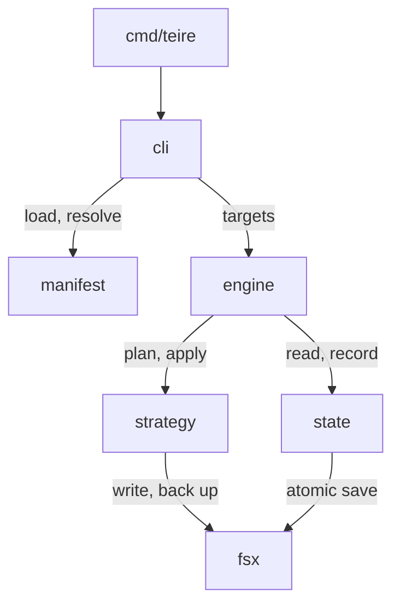

# Architecture

## Manifest

A dotfiles repository has one `teire.toml` at its root. A package is a folder
in the repository, and its layout mirrors its target folder. The package name
is also the name of its source folder, unless the package sets `source`.

Each file in a package uses the package strategy, which is `link` by default.
A file needs its own entry only when it differs from its package.

```toml
[package.claude]
target = "~/.claude"

[package.claude.file."claude.json"]
strategy = "merge"
target   = "~/.claude.json"
own      = ["mcpServers.notes"]

[host.work.package.claude]
target = "~/.claude-work"
```

The base entries describe the default machine. A host section changes only
what differs on one machine: a package target, a file target, or an extra
package.

Teire finds the host name in this order:

1. The `--host` flag.
2. The file `~/.config/teire/host`, which `teire init --host` writes. Teire
   never manages this file.
3. The output of `scutil --get LocalHostName`.

The host file exists because two Macs can have the same default name.

## Strategies

| Strategy | Apply writes                                    | State records           |
| -------- | ----------------------------------------------- | ----------------------- |
| `link`   | A symlink from the target to the source file.   | That Teire made it.     |
| `folder` | One symlink for the whole folder.               | That Teire made it.     |
| `merge`  | The target with each owned path set or deleted. | Owned paths and hashes. |

`merge` is for a file that another program also writes, such as
`.claude.json`. Teire owns only the paths in `own`:

- It sets and deletes owned paths with `sjson`, and keeps all other bytes.
- It keeps the file mode, and replaces the file with an atomic rename.
- After the write, it reads the file again and reports each owned value that
  did not stay.
- It deletes a path that left `own` only if state shows that Teire set it.
- It does not create a target file that does not exist.

## State and conflicts

The state of the last apply is in `$XDG_STATE_HOME/teire/state.json`, with one
entry for each absolute target path. The state is per machine, so it stays out
of the repository.

| Source  | Target  | Action                                       |
| ------- | ------- | -------------------------------------------- |
| same    | same    | Nothing.                                     |
| changed | same    | Write the target.                            |
| same    | changed | Report it.                                   |
| changed | changed | Ask on a terminal. Without one, exit with 2. |

Without state, Teire treats each difference as a conflict. Before each
overwrite, Teire saves the old target in
`$XDG_STATE_HOME/teire/backups/<timestamp>/`.

## Commands

- `plan` shows each change and conflict, and writes nothing. It runs when no
  command is given. It exits with 0 for no changes, 1 for changes, and 2 for
  conflicts.
- `apply` runs the plan and asks once on a terminal, then writes. `--yes`
  skips the question.
- `adopt <path>` moves a file into its package folder and links it.
- `init --host <name>` writes the host file.

## Packages



The packages follow these boundaries:

- `cmd/teire` calls only `internal/cli`.
- `internal/cli` is the only package that imports cobra. Its commands call the
  other packages through plain functions.
- `internal/fsx` is the only package that writes to disk.
- Each package gets the home folder, the state folder and the host from an
  `Env` parameter. So tests run each package against a temporary home.
